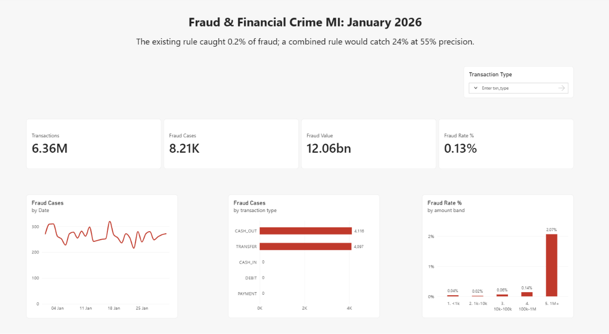
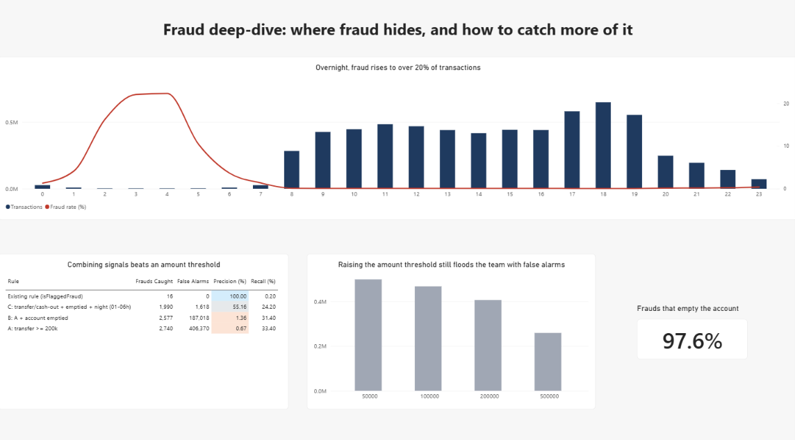
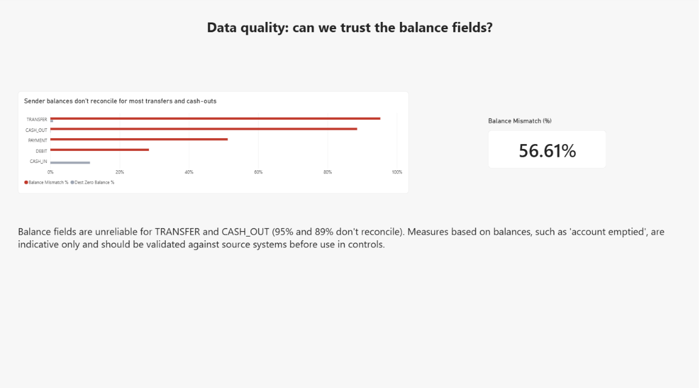

# Fraud & Financial Crime MI: Lakehouse and Power BI

An end-to-end fraud analytics project: 6.3 million mobile-money transactions are loaded into a
Databricks lakehouse, cleaned and modelled with PySpark into reporting tables, analysed in SQL,
and presented as management information (MI) in Power BI.

The question it answers: **how well does the existing fraud control work, and what would work
better?**

## Headline

The existing fraud rule caught **0.2% of fraud** (16 of 8,213 cases). Combining three signals
(transaction type, an emptied sender account and overnight timing) catches **24% of fraud at 55%
precision**: 124 times more fraud, for about 115 alerts a day.

## Architecture

```
PaySim CSV (6.3M rows)
   │  upload
   ▼
paysim_raw            Delta table, raw data as received
   │  PySpark: rename, calendar timestamps, amount bands, data quality flags
   ▼
silver_transactions   Delta table, cleaned, one row per transaction
   │  PySpark: aggregate
   ▼
gold_daily_summary    Delta table, 652 rows: day × type × amount band, with fraud and DQ counts
gold_fraud_cases      Delta table, 8,213 rows: every fraudulent or flagged transaction
   │  export
   ▼
Power BI              Star schema (Dim_Date, Dim_Type), DAX measures, 3 report pages
```

**Tools:** Databricks Free Edition (PySpark, Delta Lake, Databricks SQL), Power BI Desktop (DAX,
Power Query).

## Data

[PaySim](https://www.kaggle.com/datasets/ealaxi/paysim1): a synthetic dataset of mobile-money
transactions generated from a real company's logs, with fraud labels. PaySim records time as an
hour number (`step`); this project maps it onto a calendar starting 1 January 2026 so the report
can show dates. Amounts are in PaySim's own currency units.

## Findings

1. **Fraud is concentrated in two transaction types.** All 8,213 frauds are TRANSFER (4,097) or
   CASH_OUT (4,116). Transfers carry the highest rate: 0.77% are fraud, about 4 times the cash-out
   rate. Total fraud value is about 12.1 billion.
2. **Large transactions drive the losses.** 79% of frauds are above 100k. Above 1M the fraud rate
   is 2.07%, 16 times the overall rate of 0.13%.
3. **Fraud almost always empties the account.** 97.6% of fraudulent transfers and cash-outs leave
   the sender's balance at zero, against 42.7% of legitimate ones.
4. **Night-time is when fraud stands out.** Fraud volume is flat across the day, but legitimate
   activity collapses overnight. Between 01:00 and 06:00 about 7.7% of transactions are fraud,
   peaking above 22% at 03:00 to 04:00, against about 0.07% in the daytime.
5. **The existing control barely works.** The flagging rule caught 16 frauds (0.2% recall, 100%
   precision). A simple amount threshold doesn't fix it: flagging transfers of 200k or more would
   catch 2,740 frauds but raise 406,370 false alarms (under 1% precision).
6. **Balance data is unreliable for the riskiest types.** Sender balances don't reconcile for 95%
   of transfers and 89% of cash-outs, so balance-based measures (including finding 3) are
   indicative and carry a caveat in the report.

## Control test

| Rule | Frauds caught | False alarms | Precision | Recall |
|---|---:|---:|---:|---:|
| Existing rule | 16 | 0 | 100.00% | 0.2% |
| A: transfer ≥ 200k | 2,740 | 406,370 | 0.67% | 33.4% |
| B: A + account emptied | 2,577 | 187,018 | 1.36% | 31.4% |
| **C: transfer/cash-out + emptied + 01:00 to 06:00** | **1,990** | **1,618** | **55.16%** | **24.2%** |

**Limits:** the rules were designed and tested on the same data, so real-world performance would
be lower; the next step is to validate on a separate period. PaySim is synthetic and its balances
often don't reconcile, so the "account emptied" signal needs checking on real data.

## Power BI report

1. **Executive summary:** KPIs, fraud over time, fraud by type and by amount band.
2. **Fraud deep-dive:** fraud rate by hour of day, and the control test.
3. **Data quality:** balance reconciliation checks by transaction type.





## Repository

```
notebooks/01_build_tables.py           raw → silver → gold (PySpark)
sql/01_fraud_by_transaction_type.sql   analysis queries, in order
sql/02_fraud_by_amount_band.sql
sql/03_account_emptied_vs_fraud.sql
sql/04_fraud_by_hour_of_day.sql
sql/05_rule_threshold_test.sql
sql/06_data_quality_balance_checks.sql
sql/07_combined_rule_test.sql
powerbi/Fraud_MI_Report.pbix           Power BI report
images/                                report screenshots
```

## Author

Vinothini Balasubramani · [Portfolio](https://vinothinibs.github.io/portfolio) ·
[LinkedIn](https://linkedin.com/in/vinothini-balasubramani)
